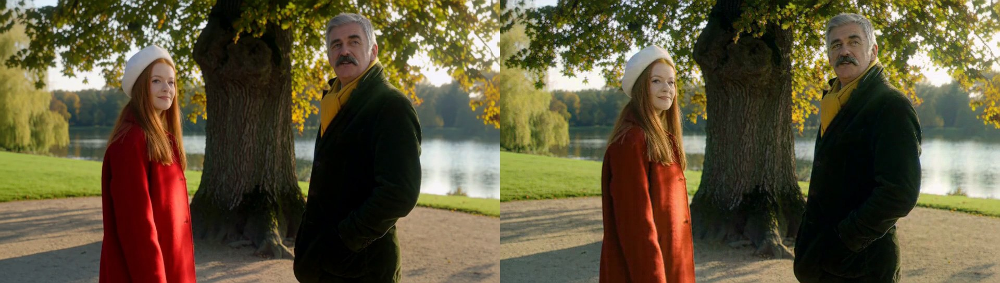
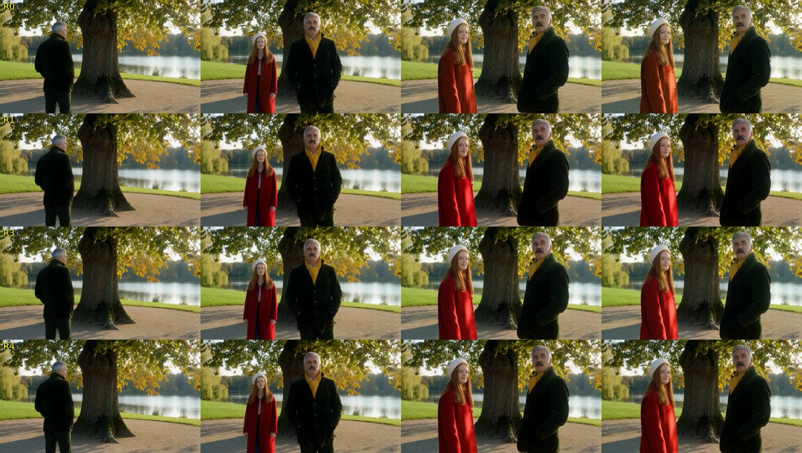

# Whole-person persistence: the park test bed (2026-11-06)

The owner's defect was never only the face: after a character walked behind something or turned away, the
hairstyle, sometimes the hair colour and even the clothes came back different. This directory is the test bed
for a generic fix: a scene with scripted disappearances, measured on the whole figure, not the face alone.

## Scene

A 22 s 960x544 Ref2VA clip (two 277-frame windows, seed 2601, 20 steps, reference short edge 1024), rendered from
the model's own 5 s frame (`reference-640.png`): a thick oak in the middle, a woman in a red coat and a white hat
on the left, a man with grey hair, a moustache, a green corduroy jacket and a yellow scarf on the right.

- window 1: the woman walks behind the trunk, is hidden for about two seconds and comes out next to the man;
- window 2: the man turns his back to the camera for about three seconds and turns back; the woman returns behind
  the trunk to her place.

Three reference sets on one boot, everything else equal (queue97 on Spark_06):

| variant | request images | render | peak |
|---|---|---|---|
| V0 | the scene frame | 1191 s | 62.3 GB |
| V1 | scene + a head-and-shoulders card per character (`make_character_cards.py`) | 1501 s (+26 %) | 63.5 GB |
| V2 | scene + head cards + full-figure cards (`--body`) | 1881 s (+58 %) | 64.9 GB |

## Measurements

Whole person: `scripts/person_bank.py` (DINOv2 figure + upper-body embeddings of every detected person at 2 fps
against the character cards; a person is judged only when a confident face shows in the upper part, else
`unjudged`). Faces: `scripts/face_bank.py` against the scene frame + head cards and `scripts/face_drift.py --match
embed` against the scene frame. Cuts: `select=gt(scene,0.1)`.

| | V0 scene only | V1 + head cards | V2 + head + body cards |
|---|---|---|---|
| persons w1: mean best / min / unknown / unjudged | 0.865 / 0.42 / 0 / 2 | 0.874 / 0.56 / 0 / 2 | 0.883 / 0.56 / 0 / 2 |
| persons w2: mean best / min / unknown / unjudged | 0.827 / 0.57 / 0 / 4 | 0.836 / 0.56 / 0 / 1 | 0.840 / 0.57 / 0 / 4 |
| faces w1: mean / min / unknown frames | 0.868 / 0.48 / 0 | 0.870 / 0.25 / 1 | 0.908 / 0.59 / 0 |
| faces w2: mean / min / unknown frames | 0.869 / 0.72 / 0 | 0.859 / 0.53 / 0 | 0.878 / 0.56 / 0 |
| drift, woman: first 10 % -> last 10 % | 0.78 -> 0.85 | 0.78 -> 0.88 | 0.84 -> 0.89 |
| drift, man: first 10 % -> last 10 % | 0.91 -> 0.90 | 0.92 -> 0.92 | 0.94 -> 0.91 |
| cuts | 0 | 0 | 0 |

(V0's person rows re-scored offline with the face-gated rule; its live run used the first rule and reported 2 + 4
unknown frames, all back views.)

`sheet-woman-V012.jpg` and `sheet-man-V012.jpg`: the same frames of the three variants (rows V0, V1, V2) around the
two events, cropped to each character.

## What it shows

- **The short probe does not reproduce the defect.** With the scene frame alone the woman comes back from behind the
  oak in the same hat, hair and coat, and the man turns back with the same hair, moustache and scarf, in one take.
  Both events happen inside a window, where the diffusion sees the character before and after the occlusion.
- The cards lift the numbers a little and consistently: V2 has the best face means in both windows (0.908 / 0.878
  against 0.868 / 0.869), the best figure means (0.883 / 0.840 against 0.865 / 0.827) and the smallest drift of
  the woman's face; the head cards alone are in between and produced the one low frame (0.25, a half-turned face
  at the trunk). The lift costs 26 % (head cards) and 58 % (head + body cards) of the render time at 960x544.
- The whole-person scorer behaves: 0 unknown persons in all six windows, the back views and the half-hidden
  figures `unjudged` (0.42-0.57 against the frontal cards, the same range as a stranger in similar clothes on the
  120 s shop clip, which is why a figure without a face is not judged).

## The seam test: hidden at the window hand-over (queue98)

The same scene with the events moved onto the hand-over: window 1 ends with the woman behind the trunk and the man
with his back to the camera, window 2 brings both back (`tree/prompt_seam.txt`, `extra_seam.json`, seed 2601).

| | S0 scene only | S2 scene + head + body cards, guard (faces, figure embeddings) |
|---|---|---|
| the man (turned away, never hidden) | the same man | the same man |
| the woman (hidden) after the hand-over | **another person**: an open orange-brown coat over a white blouse and a blue skirt instead of the closed red coat, blonder hair, an older face | the same change (the cards do not prevent it) |
| figure embedding vs her card, after | 0.86-0.92 ("known") | 0.90 |
| face vs her head card, after | 0.76-0.78 ("known") | 0.83 |
| colour distance to her cards, after (hair + torso) | 15-27 (10 of 11 instances above 15) | 15-28 (10 of 12) |
| colour distance before the seam | 5-9 | 3-7 |
| guard verdict (bank without colour) | - | window 2 accepted: 10 faces, 0 % unknown |
| render | 1239 s | 1956 s |

`sheet-seam-S0-vs-reference.jpg`, `sheet-seam-S2-vs-reference.jpg`: the reference frame and five frames of each clip.

**This is the owner's defect**, and it is a hand-over problem: with the character absent from the overlap frames the
next window invents her from the prompt and the references, and the references lose (the same with five reference
images as with one). The embedding checks pass the invented woman (same type of person, 0.86-0.92), which is why
`scripts/person_bank.py` got the colour signature: hair, torso and legs regions placed relative to the face box,
hue and saturation each, compared with the character's cards (hue weighted by chroma, saturation by brightness, so the
shop clip's near-black clothes carry no noise); above 15 the person is `changed`. Over the four clips every window of
the same person scores 0-12 (the 120 s shop clip 0-5 in all ten windows), the invented woman 15-28.

Prevention did not come from the cards. The guard's re-sample with the colour check was tried next (queue100, S2c).

## What the guard saw and what the clip shows (queue100)

S2c is S2 once more with the colour check live in the guard (`H3_TP2_IDENTITY_GUARD=0.1 GROW=0.6 PERSON_SIM=0.6`). Two
things came out of it:

- **Renders are deterministic at a fixed seed.** S2 and S2c (same request, same seed) have the same `framemd5`, so the
  invented woman of S2 is not a lottery of the run but of the seed: only another seed is a new draw.
- **The guard passed window 2 (0 % unknown, colour distance 3-5 to the cards) and the clip still shows the orange coat
  and another face.** The frame below is the guard's decoded sample of window 2 on the left and the same frame of the
  finished clip on the right: the identity check runs on the raw sample inside the attempt loop, and the look-lock
  (`H3_TP2_CONT_LOCK=first`, the per-class latent statistics of every later window pulled toward window 1's tail) is applied
  to the chosen window afterwards. In this scene window 1's tail is the moment the woman is hidden and the man shows his
  back, so the lock moves the returning character toward a window without her: the coat goes red -> orange (torso hue
  3 -> 11-18, over the colour limit) and the face changes with it. The audio look-lock sits at the same place.

Two guard defects found on the way are fixed (7bf65a5): the person bank lost its colour signatures at the first growth,
and a head crop and a body crop of one character were two characters, so a figure matched to the head crop was never
colour-checked against the body crop's torso.

## The look-lock on the saved latents (queue107)

The two saved S2c windows were replayed through the hand-over with no diffusion (`H3_TP2_REPLAY_LATENTS`, one glob per
window so that every rank finds its own copy), once per lock variant. Window 1 is the same in all five clips; the
numbers are window 2, where the woman is back.

| arm | lock | persons `changed` | colour distance max / mean | faces mean | woman's face, first 10 % -> last 10 % | UTMOS w2 |
|---|---|---|---|---|---|---|
| R0 | default (`first`, strength 1, per-class mean + std) | **10 of 35** | **27.7** / 11.7 | 0.829 | 0.84 -> 0.72 | 3.14 |
| R1 | off | 0 | 10.5 / 4.4 | 0.879 | 0.84 -> 0.84 | 3.47 |
| R2 | strength 0.5 | 0 | 14.4 / 6.3 | 0.854 | 0.84 -> 0.78 | 3.45 |
| R3 | mean only (`H3_TP2_CONT_LOCK_STD=0`) | 0 | 10.7 / 5.9 | 0.864 | 0.84 -> 0.81 | 3.14 |
| R4 | robust (`H3_TP2_CONT_LOCK_ROBUST=1`) | 0 | 11.6 / 5.7 | 0.858 | 0.84 -> 0.79 | 3.14 |

R0 reproduces S2c bit for bit (framemd5 `fa977861...`), so the replay stands for the render. `sheet-lock-replay.jpg`:
four frames of window 2 (13, 16, 19, 21.5 s), rows R0, R1, R3, R4.

- **The default lock is what turns the coat orange**, and it does it along the window (the correction is ramped): red
  at 16 s, orange at 19 s and 21.5 s. With the lock off the same latents decode to the red coat and the same face in
  every frame.
- **Most of the damage is the gain**, not the shift: the mean-only lock (R3) keeps the coat (colour distance 10.7
  against 10.5 with no lock) and the face (0.864).
- **The robust lock keeps the character** (0 changed, 11.6, the coat red in every frame of the sheet): its statistics
  come from the positions that did not change between window 1's tail and the new window, so the returning figures do
  not enter them. Half strength stays just under the colour limit (14.4 of 15).
- The voice column is the audio look-lock, which rides on the same switch: window 2 scores 3.47 without it and 3.14
  with it (R2 runs it at half strength: 3.45). Window 1's tail in this scene is the quiet moment before the woman
  returns, and the lock pulls the speech of window 2 toward it (audio latent std 0.349 -> 0.255, reference 0.210).
  Followed up in `results/20261106-voice/`.

What the replay cannot show is the reason the lock exists: the slow whole-frame drift over many windows. Queue104
rendered the 60 s painting clip with no lock, the default, the robust and the mean-only lock to see which of them still
holds the brightness.

## The 60 s painting with and without the lock (queue104)

The Koninck landscape, 960x544, 20 steps, seed 1101, FL2VA, six windows, one boot per arm, everything else the defaults
(`clip-metrics.sh`, `luma_flicker.py`, `volumedetect` per 10 s):

| arm | light per second, min-max (window 1: 115-139) | light at 30 / 45 / 60 s | seam luma steps | 17-frame flicker | cuts | audio per 10 s (dB) | render |
|---|---|---|---|---|---|---|---|
| K-off, no lock | 115-140 | 139 / 137 / 131 | 0.0 -0.1 -0.1 -0.0 -0.1 | none | 0 | -49.1 -43.5 -42.3 -43.2 -39.6 -45.1 | 2994 s |
| K-lock, the plain lock | 115-142 | 142 / 138 / 139 | 0.0 -0.3 -0.2 0.0 -0.1 | none | 0 | -49.1 -43.6 -43.1 -44.6 -41.9 -48.8 | 2949 s |
| K-robust | 115-141 | 140 / 139 / 136 | 0.0 0.0 -0.0 -0.0 0.0 | none | 0 | -49.1 -43.6 -43.1 -44.1 -41.3 -49.0 | 2957 s |
| K-mean, mean only (`LOCK_STD=0`) | 115-143 | 143 / 137 / 139 | +0.1 -0.3 -0.4 -0.1 -0.2 | none | 0 | -49.1 -43.6 -43.2 -44.1 -41.9 -47.4 | 2936 s |

- **On today's code the painting does not drift without the lock.** The light climbs from 115 to 139 inside window 1 (the
  model brightening the painting's tone, in every arm the same) and then stays between 131 and 140 for the remaining five
  windows; the colour means move by one unit; the five seams step 0.0-0.1 luma; no cut, no flicker. The 47 -> 88 drift the
  lock was built against (2026-10-30) came from the plain continuation of that day; the pinned prefix, the seam and cut
  checks, the seed per window and the later-window wording have since removed it.
- **The robust lock behaves like the plain lock where there is nothing to protect** (inliers 88-93 % of the positions; light
  within one unit of K-lock, seams the flattest of the four; the mean-only lock is the brightest, 143, with the largest seam
  steps, -0.3 / -0.4), and unlike it where there is (the seam scene above). It is
  the default since 2026-11-07 (`H3_TP2_CONT_LOCK_ROBUST=1`; `0` restores the plain lock).
- **The audio lock is off by default since the same day.** Without it the ambience of this clip moves between -39.6 and
  -49.1 dB (the step after window 1 is in every arm; window 1's tail is quiet); with it 1-4 dB less in the louder
  windows. The 23 dB climb of 2026-10-30 does not reproduce. Against that, a window of speech after a quiet tail lost
  0.33 UTMOS to it (R0 vs R1 above). A level-only latent lock was analysed as a replacement and dropped: the quiet-step
  floor of the audio latents is flat within 1-3 dB over every window of this clip, the seam scene and the 118 s doll
  clip, while the decoded loudness of this clip moves 10 dB, so the latent level does not carry the loudness
  (`results/20261106-voice/` section 8). `H3_TP2_CONT_LOCK_AUDIO=1` re-enables it.

Queue111 renders the seam scene once more as a real render with the new defaults (`tree-seam-S3`, the same request and
seed as S2c): the video should decode like R4, the voice like R1.
